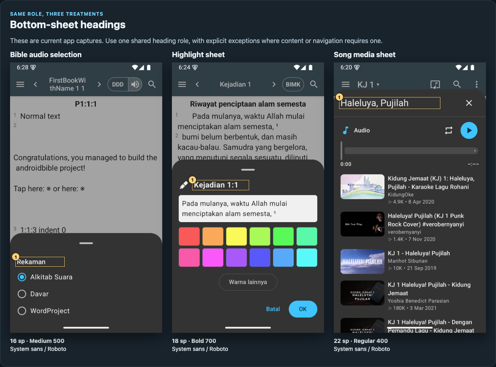
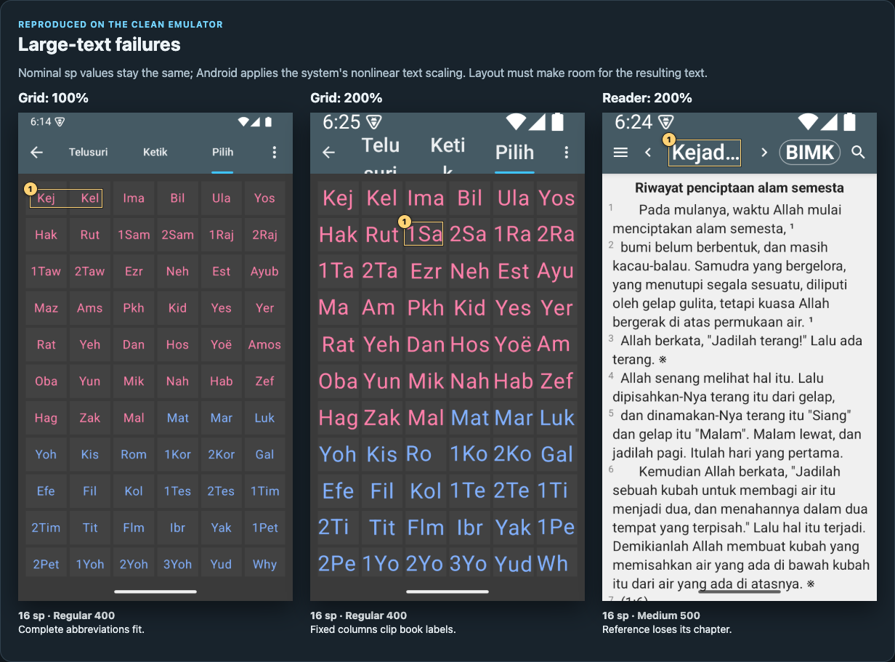

# App typography audit (1 November 2026)

**The proposed UI scale is now implemented.** [Open the before/after comparison report](comparison/index.html) for 75 screen/state pairs, or read the [implementation and coverage notes](comparison/README.md). This implementation deliberately excludes the 200% text-scale layout issues. The original audit below is retained as historical evidence.

The app has avoidable variation in typography for controls and headings. The annotated sample contains **19 native UI size/weight pairs**. The proposed shared UI scale uses eight pairs, while retaining user-selected reading typography and semantic article/song formatting.

[Open the complete HTML report](index.html). The HTML embeds every raw screenshot, so downloading this one file is enough to read the visual report offline. It includes 35 annotated screens, per-item suggestions, source definitions, an observed-style inventory, a proposed type scale, coverage limits, and reproducible commands. Local source links and supporting JSON require the accompanying folder.

## Original audit findings

- At 200% system font size, Go To tab labels are cut off and the six-column book grid clips abbreviations.
- At the same size, the reader reference loses its chapter number to truncation.
- Equivalent sheet headings use 16sp medium, 18sp bold, and 22sp regular.
- Version descriptions, section labels, keypads, and timing labels introduce avoidable one-off sizes or weights.
- Reading-content variation has meaningful roles and should be preserved. It is excluded from the native UI pair count.

## Evidence and validation

The audit used a new worktree based on the freshly fetched develop branch, a successful plainDebug build, and a clean Android 15 emulator. Public BIMK and KJ content was downloaded; no account was signed in. App behavior and production source files are unchanged.

Android CLI installed/launched the build and captured the live layout JSON. Its installed screenshot command has no device selector and fails with multiple online emulators, so screenshots use the documented device-specific adb fallback. Each annotation states the source-resolved font, weight, and nominal size. CSS px and reader-controlled dp are labeled separately from sp.

The report was visually checked. Browser validation passed for desktop/mobile overflow, all embedded images, local source paths, and section/priority filters. The emulator font scale was restored to 1.0 and audio was paused/closed. No application tests were added or run for this documentation-only change. Some less-common states, widgets, fonts, locales, and legacy paths were source-reviewed only; the report identifies them explicitly.

- [Capture metadata](capture-metadata.json)
- [Annotation data and per-item recommendations](evidence.json)
- [Observed UI pairs](observed-ui-pairs.json)
- [Bounded literal-size inventory](explicit-sizes.json)
- [Renderer validation](validation.json)
- [Raw screenshots](raw/), [Android CLI layouts](layouts/), and [annotated exports](annotated/)

## Regeneration

Run `python3 inventory.py` from this directory to refresh the bounded source inventory. It scans explicit XML text sizes and direct Kotlin font-size assignments, including legacy resources and previews. It does not resolve all inherited or dynamic styles.

Run `node build-report.cjs` to rebuild the standalone HTML from `evidence.json` and the raw PNGs. Run `node build-report.cjs --render` in an environment with Playwright and Chromium installed to regenerate all annotated PNGs and browser validation. If using an installed Chrome instead of Playwright's bundled Chromium, set `PLAYWRIGHT_CHROMIUM_CHANNEL=chrome`. Configure `NODE_PATH` if Playwright is supplied by an external runtime.

The shared XML/Compose typography and scoped Android catalog CSS are implemented in the [comparison report](comparison/index.html). The large-text layout findings remain outside the requested scope.
